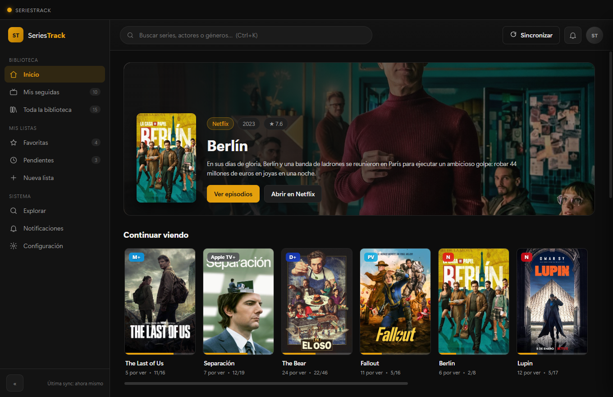
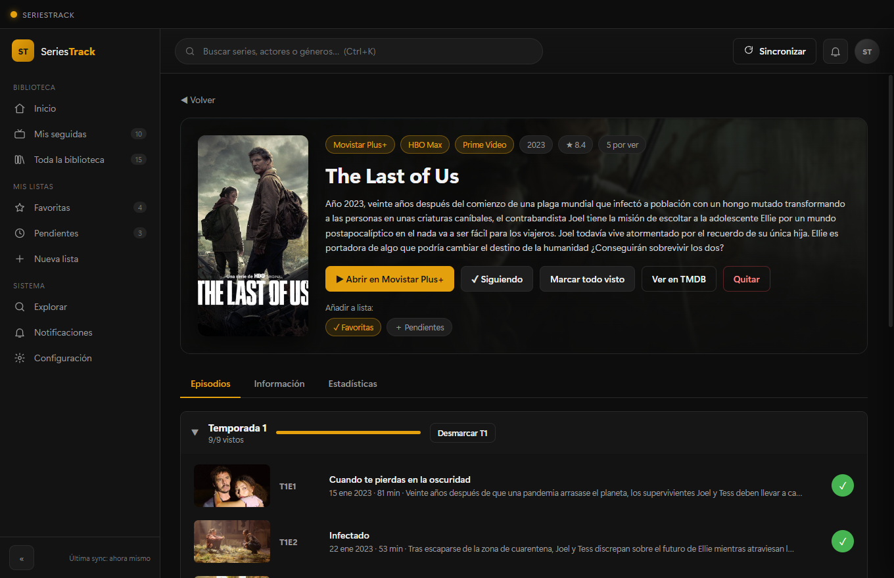
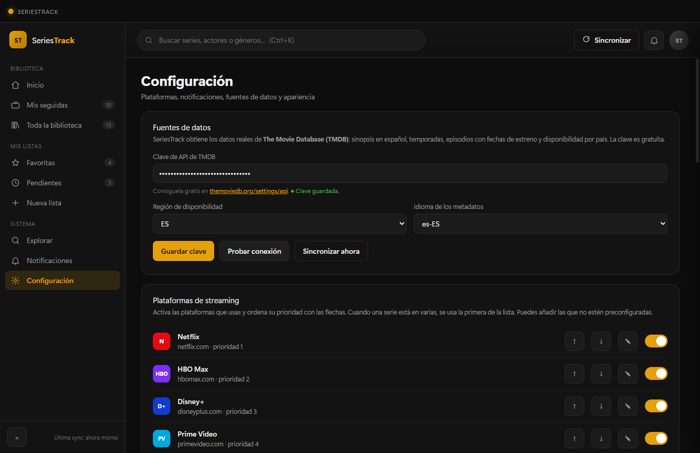
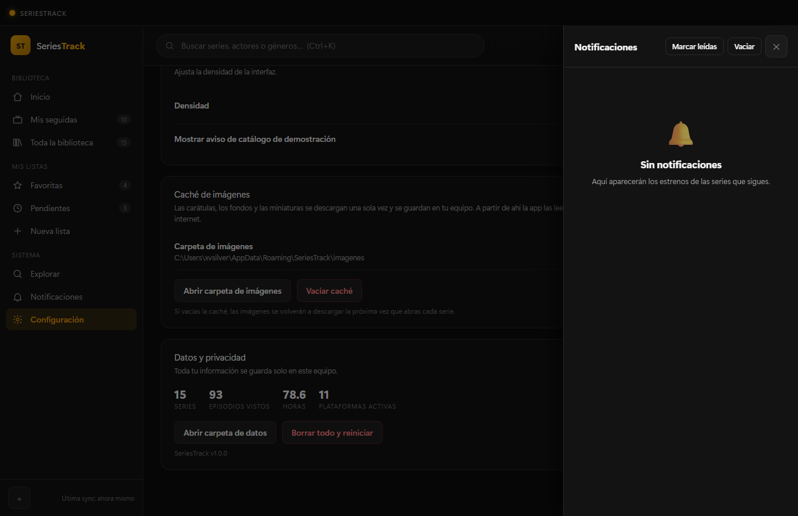
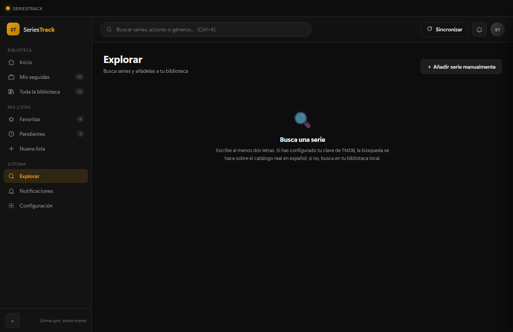

# SeriesTrack

[](../../releases/latest)
[](LICENSE)
[](#instalación)
[](https://www.electronjs.org/)

Aplicación de escritorio para Windows para **seguir series y episodios** de las principales
plataformas de streaming, con una interfaz limpia y visual inspirada en Plex.



---

## Qué hace

| Función | Detalle |
|---|---|
| **Seguimiento de series** | Biblioteca con progreso por episodio, estado (*Al día*, *N por ver*, *Sin empezar*) y anillo de progreso en cada carátula. |
| **Avisos de nuevos episodios** | Notificación nativa de Windows + centro de notificaciones dentro de la app, en cuanto se estrena un capítulo de una serie que sigues. |
| **Vista detallada** | Carátula, sinopsis, plataforma(s), valoración, géneros y **lista completa de episodios** por temporada con marca de visto. |
| **Gestión de progreso** | Marcar/desmarcar episodios a un clic, marcar una temporada entera o la serie completa. |
| **Listas personalizadas** | *Favoritas* y *Pendientes* de serie, más listas propias ilimitadas. |
| **Plataformas ampliables** | 12 plataformas preconfiguradas (Netflix, HBO Max, Disney+, Prime Video, Apple TV+, Movistar Plus+, SkyShowtime, Filmin, Atresplayer, RTVE Play, Crunchyroll, Rakuten TV) y un formulario para **añadir plataformas propias**. |
| **Búsqueda** | Buscador global (Ctrl+K) sobre tu biblioteca y sobre el catálogo real de TMDB. |
| **Vinculación con TMDB** | Convierte el catálogo de demostración en datos reales (episodios, carátulas y plataformas) **conservando tu progreso**. |
| **Caché de imágenes local** | Carátulas, fondos y miniaturas se descargan **una sola vez** y se guardan en una carpeta del equipo; después se leen del disco. |
| **Bandeja del sistema** | La app sigue vigilando estrenos minimizada, con menú propio en el área de notificación. |

---

## Instalación

Descarga el instalador desde la sección **[Releases](../../releases)** de este repositorio:

- **`SeriesTrack-Setup-x.y.z.exe`** → instalador (permite elegir carpeta, crea accesos
  directos en el escritorio y en el menú Inicio, y trae desinstalador).
- **`SeriesTrack-Portable-x.y.z.exe`** → versión portable, sin instalación.

Requisitos: **Windows 10/11 de 64 bits**. No necesita Python, Node ni nada adicional.

> El ejecutable **no está firmado digitalmente** (requiere un certificado de pago), así que
> Windows SmartScreen puede mostrar un aviso la primera vez: *Más información → Ejecutar de
> todas formas*.

¿Prefieres compilarlo tú mismo? Salta a [Desarrollo](#desarrollo).

---

## Primeros pasos

1. Al abrirla verás un **catálogo de demostración** con 15 series y 168 episodios para que la
   app esté completa desde el primer segundo, sin configuración ni conexión.
2. Para pasar a **datos reales**: ve a **Configuración → Fuentes de datos**, pega tu clave de
   TMDB (gratuita, se obtiene en <https://www.themoviedb.org/settings/api>) y pulsa
   *Probar conexión*.
3. Pulsa **«Vincular N series del catálogo con TMDB»**: busca cada serie de demostración en
   TMDB, sustituye sus episodios por los reales y **conserva tu progreso** emparejando
   temporada y número de episodio. También puedes vincular una sola serie desde su ficha.
4. Busca más series en **Explorar** (Ctrl+K) y pulsa **Seguir**.

A partir de ahí la app comprueba sola si hay episodios nuevos, con la frecuencia que elijas
(15 min – 12 h) y avisa con una notificación de Windows.

También puedes configurar la clave sin abrir la app:

```powershell
node scripts/set-tmdb-key.js <tu-clave>
node scripts/set-tmdb-key.js --show
```

---

## Cómo funciona el seguimiento (sin humo)

- **Metadatos, temporadas, episodios y fechas de estreno reales** → **TMDB**, en español, con
  la región de disponibilidad que elijas (ES, MX, AR, CO, CL, PE, US).
- **Disponibilidad por plataforma** → `watch/providers` de TMDB para tu región, cruzada con la
  tabla de plataformas de la app.
- **Detección de estrenos** → el planificador compara el catálogo con la base local y genera
  una notificación por cada episodio emitido y no visto, con deduplicación por
  `(serie, temporada, episodio)`.
- **Sin clave de TMDB** la app funciona igualmente en **modo local**: usa el catálogo incluido
  (que contiene episodios con fechas de estreno cercanas a hoy), de modo que el motor de
  avisos se puede probar de verdad.
- **Plataformas personalizadas** → se guardan con nombre, color, dominio y prioridad. Se usan
  para asignar series manualmente y para el botón *Abrir en…*.

Lo que la app **no** hace, para ser honestos: no descarga vídeo, no inicia sesión en tu cuenta
de Netflix/HBO y no hace *scraping* de sus catálogos (sus términos de uso no lo permiten y
además se rompería a la semana). Los datos de estrenos vienen de TMDB, que es la fuente
pública y estable.

---

## Tus datos

Todo se guarda **solo en tu equipo**:

```
%APPDATA%\SeriesTrack\
├── seriestrack-data.json   ← series, progreso, listas, ajustes y notificaciones
└── imagenes\               ← carátulas, fondos y miniaturas ya descargadas
    ├── w342\               (carátulas)
    ├── w300\               (miniaturas de episodio)
    └── w1280\              (fondos)
```

Las imágenes se descargan **una sola vez**: la primera vez que se muestra una carátula se
guarda en `imagenes\` y a partir de ahí se lee del disco (por eso la app abre rápido y no
vuelve a pedirla a internet). Desde *Configuración → Caché de imágenes* puedes ver cuánto
ocupa, abrir esa carpeta o vaciarla.

Sin cuentas, sin telemetría, sin servidores intermedios. Desde *Configuración → Datos y
privacidad* puedes abrir la carpeta de datos o borrarlo todo y empezar de cero.

---

## Capturas

| Detalle de serie | Configuración |
|---|---|
|  |  |

| Notificaciones | Explorar |
|---|---|
|  |  |

---

## Desarrollo

```powershell
npm install          # dependencias (Electron + electron-builder)
npm start            # abre la app en modo desarrollo
npm test             # 41 comprobaciones de la lógica, sin interfaz
npm run smoke        # arranca, captura las pantallas y sale (build/smoke-*.png)
npm run icon         # regenera build/icon.ico y assets/icon.ico (solo stdlib de Python)
```

Variables de entorno útiles para el diagnóstico:

| Variable | Efecto |
|---|---|
| `ST_SMOKE_LINK=1` | Al hacer `npm run smoke`, vincula primero el catálogo con TMDB (prueba del flujo real). |
| `ST_SMOKE_DIR=<ruta>` | Carpeta donde se guardan las capturas del modo diagnóstico. |

### Estructura

```
seriestrack/
├── main.js                  # proceso principal: ventana, bandeja, notificaciones, IPC
├── preload.js               # puente seguro (contextBridge) hacia la interfaz
├── src/
│   ├── seed.js              # catálogo de demostración y valores por defecto
│   ├── store.js             # persistencia JSON con escritura atómica
│   ├── catalog.js           # dominio: series, temporadas, episodios, progreso, listas
│   ├── tmdb.js              # cliente de TMDB (búsqueda, detalle, temporadas, proveedores)
│   └── scheduler.js         # motor de detección de estrenos y notificaciones
├── renderer/                # interfaz (HTML + CSS + JS sin frameworks)
├── scripts/
│   ├── selftest.js          # pruebas automáticas de la lógica
│   ├── make-icon.py         # genera el icono multi-resolución
│   ├── set-tmdb-key.js      # configura la clave de TMDB desde la terminal
│   └── fix-wincodesign.ps1  # prepara la caché de empaquetado en Windows
└── build/, assets/          # recursos e iconos
```

### Generar el instalador

```powershell
powershell -ExecutionPolicy Bypass -File scripts\fix-wincodesign.ps1
npm run dist
```

**Sobre `fix-wincodesign.ps1`:** al empaquetar, electron-builder descarga el paquete
`winCodeSign` y lo descomprime. Ese paquete incluye una carpeta `darwin` con enlaces
simbólicos que Windows no puede crear sin *Modo desarrollador* o permisos de administrador,
y el build falla con:

```
ERROR: Cannot create symbolic link : El cliente no dispone de un privilegio requerido.
```

El script extrae el paquete excluyendo `darwin` y `linux` (para compilar en Windows solo se
usan `windows-*` y `rcedit-*.exe`) y lo deja en la caché con el nombre exacto que espera
electron-builder. Es un paso único por máquina. Alternativa: activar el *Modo desarrollador*
de Windows.

---

## Licencia

MIT.
